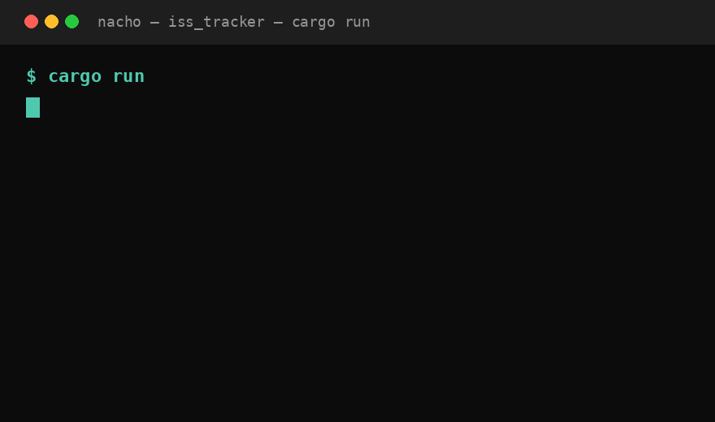

# 🛰️ ISS Tracker

Tracker en vivo de la Estación Espacial Internacional desde la terminal. Hecho en **Rust** para aprender el lenguaje con un proyecto real de ~100 líneas.



> Consulta la posición real de la ISS cada 2 segundos y calcula a cuántos km está de vos (en mi caso Buenos Aires).

---

## ✨ Qué hace

- 📡 Polling cada 2s a la API pública `wheretheiss.at` (satélite `25544` = ISS)
- 📍 Muestra en vivo: latitud, longitud, altitud, velocidad y visibilidad (`daylight` / `eclipsed`)
- 📏 Calcula la distancia 3D con trigonometría esférica (Haversine + Teorema del Coseno) considerando la altitud orbital, no solo sobre el mapa plano
- 🧹 Refresca la terminal con ANSI (`\x1B[2J`) para efecto "en vivo"
- ⚡ Loop asíncrono con `tokio` sin bloquear el hilo

Ejemplo de salida:

```
=== ISS Tracker (En Vivo) ===
Satelite:     iss
Latitud:      -25.9814°
Longitud:     -26.9705°
Altitud:      423.80 km
Velocidad:    27573.39 km/h
Visibilidad:  daylight
-----------------------------
Distancia:    3253.86 km
```

## 🏗️ Arquitectura

Proyecto chico y explícito, 3 archivos:

```
iss_tracker/
├── Cargo.toml
└── src/
    ├── main.rs    → loop principal, intervalo tokio, render en terminal
    ├── client.rs  → cliente HTTP + struct IssPosition (serde)
    └── geo.rs     → struct Observer + cálculo de distancia
```

Flujo:

```
┌──────────┐   cada 2s   ┌──────────────────────────────┐
│  tokio   │ ──────────► │  GET wheretheiss.at/v1/      │
│ interval │             │  satellites/25544             │
└──────────┘             └──────────────┬───────────────┘
                                        │ JSON
                                        ▼
                              ┌──────────────────┐
                              │  IssPosition     │
                              │  lat/lon/alt/vel │
                              └────────┬─────────┘
                                       │
                       ┌───────────────┴───────────────┐
                       │                               │
                       ▼                               ▼
              ┌────────────────┐              ┌────────────────┐
              │  print terminal│              │ Observer::      │
              │  + ANSI clear  │              │ distance_to()  │
              └────────────────┘              └────────────────┘
```

### Por qué así

- **`client.rs` separado:** todo lo de red/serde aislado, `main.rs` no sabe de URLs ni JSON.
- **`geo.rs` separado:** la matemática (Haversine + altitud) testeable sin red.
- **`main.rs` fino:** solo orquesta: tick → fetch → calcular → pintar.

## 📏 Cómo se calcula la distancia

El Haversine clásico da distancia *sobre la superficie*. Como la ISS va a ~420 km de altura, eso subestima bastante.

1. Calculo el ángulo central `θ` con Haversine entre (observador) y (punto sub-satélite).
2. Aplico ley de cosenos en 3D con dos radios distintos:

```
R1 = 6371.0 (tierra)
R2 = 6371.0 + altitud_iss
dist = sqrt(R1² + R2² - 2·R1·R2·cos(θ))
```

Ver implementación en [`src/geo.rs`](src/geo.rs).

## 🚀 Instalación y uso

Requisitos: Rust 1.80+ (edition 2024) + conexión a internet.

```bash
# 1. Clonar
git clone https://github.com/alvarezig/iss-tracker.git
cd iss-tracker

# 2. Correr
cargo run --release
```

Salir con `Ctrl + C`.

### Cambiar tu ubicación

En [`src/main.rs`](src/main.rs#L12):

```rust
// Lanús, Buenos Aires por defecto
let me = Observer::new(-34.728, -58.428);

// Ej: Madrid -> Observer::new(40.4168, -3.7038)
// Ej: CDMX   -> Observer::new(19.4326, -99.1332)
```

Guardá y volvé a correr con `cargo run`.

## 🧰 Stack

| Tech | Para qué |
|------|----------|
| [Rust](https://www.rust-lang.org/) | Lenguaje |
| [tokio](https://tokio.rs/) `full` | Runtime async + `interval` cada 2s |
| [reqwest](https://docs.rs/reqwest/) `json` | Cliente HTTP para pegarle a la API |
| [serde](https://serde.rs/) `derive` | Deserialización directa del JSON a structs |
| [wheretheiss.at](https://wheretheiss.at/) | API pública, sin key |

## 🎓 Qué aprendí (para portfolio)

- Async real con `#[tokio::main]` + `interval.tick().await` sin bloquear.
- Modelado con `struct` + `impl`, ownership básico sin `clone()` de más.
- Deserialización directa `response.json::<IssPosition>().await`.
- Secuencias ANSI para UI en terminal.
- Que un error chico en la fórmula (ignorar altitud) te mueve el resultado cientos de km.

## 🗺️ Roadmap

- [ ] Alerta cuando la ISS pase a < 500 km ("¡salí a mirarla!")
- [ ] Modo TUI con `ratatui` + mapita ASCII
- [ ] Tests unitarios para `geo.rs` (casos borde: antípodas, cenit)
- [ ] Flag `--lat --lon` por CLI en vez de hardcode
- [ ] Soportar otros satélites (HST, Tiangong)

## 📡 API

```
GET https://api.wheretheiss.at/v1/satellites/25544
```

Respuesta (recortada):

```json
{
  "name": "iss",
  "id": 25544,
  "latitude": -25.98,
  "longitude": -26.97,
  "altitude": 423.80,
  "velocity": 27573.39,
  "visibility": "daylight"
}
```

Sin autenticación. Rate limit generoso, pero no bajar de 1s entre requests.

---

Hecho por Nacho para aprender Rust. Si te sirve para aprender, forkealo y rompelo.
